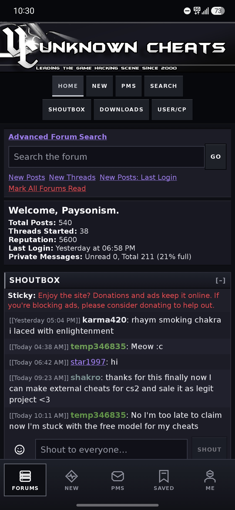
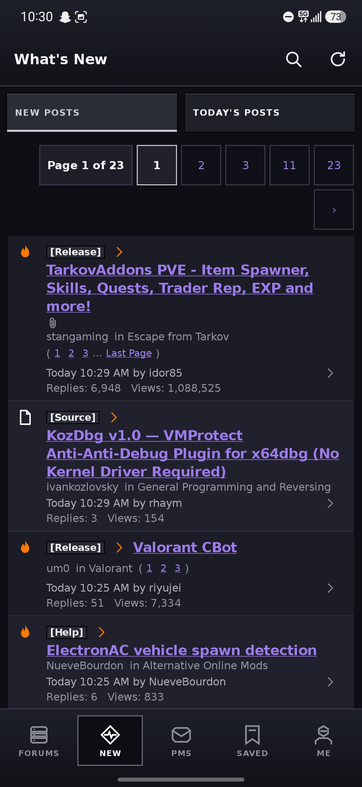
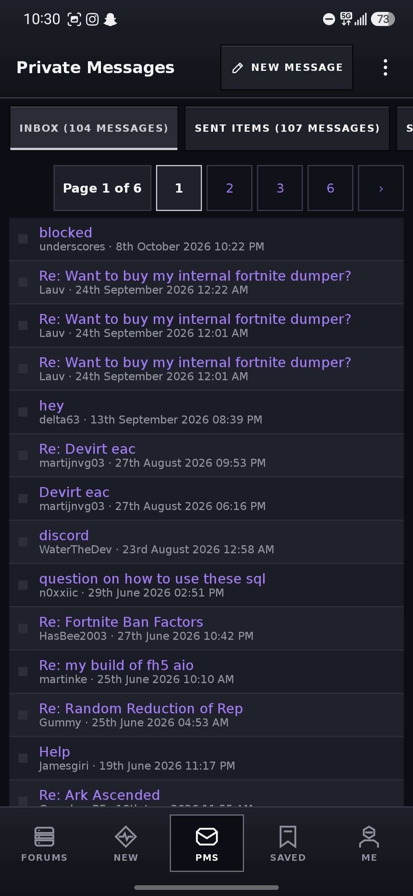
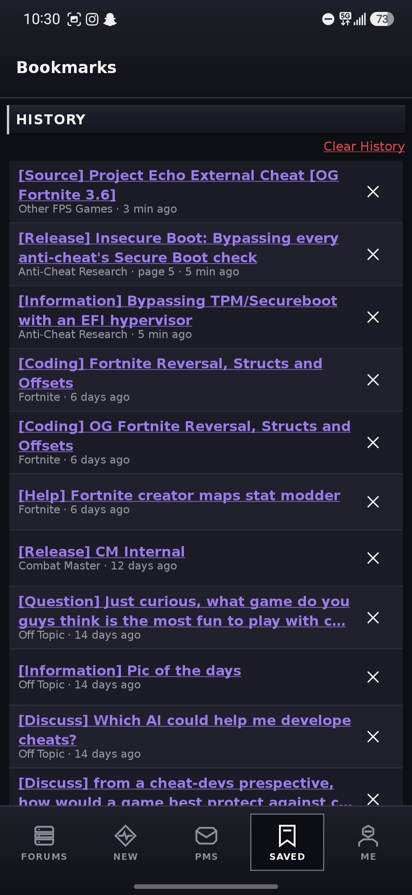
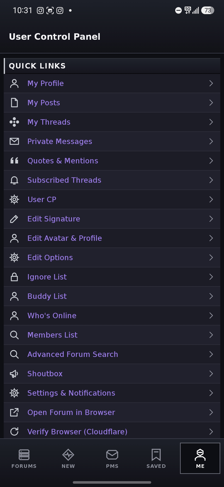
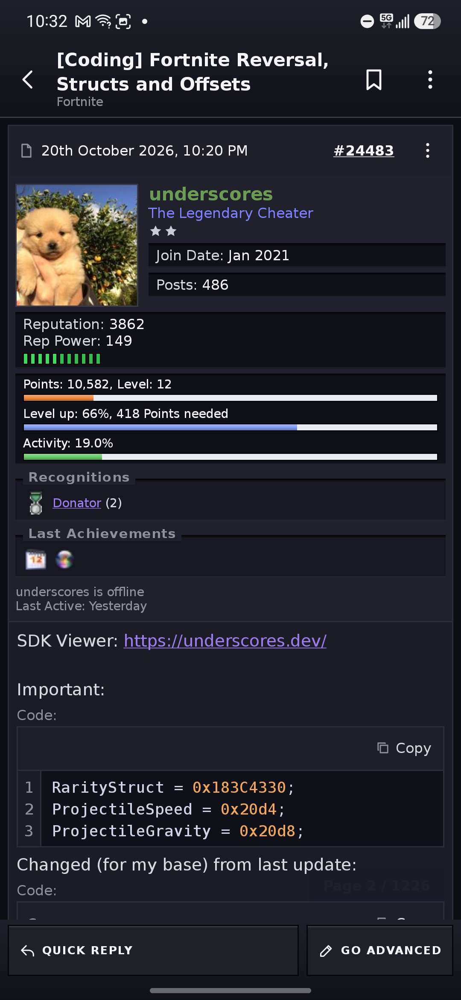
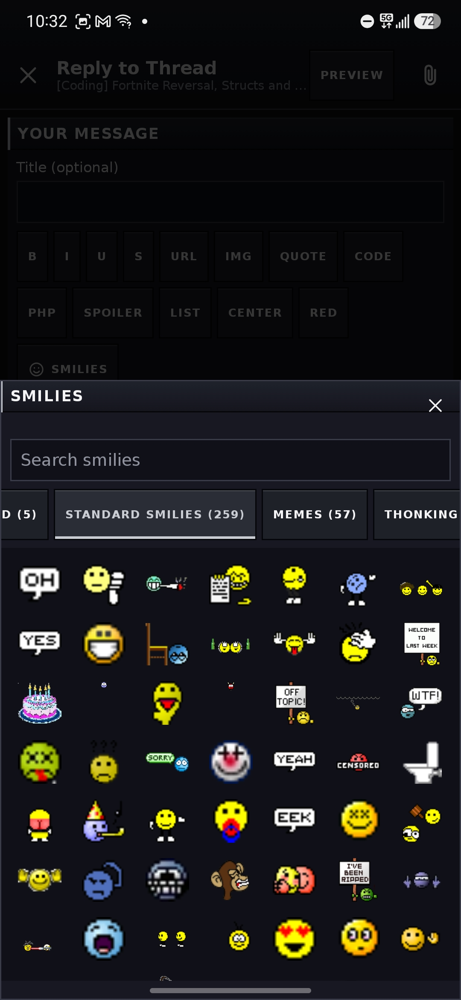
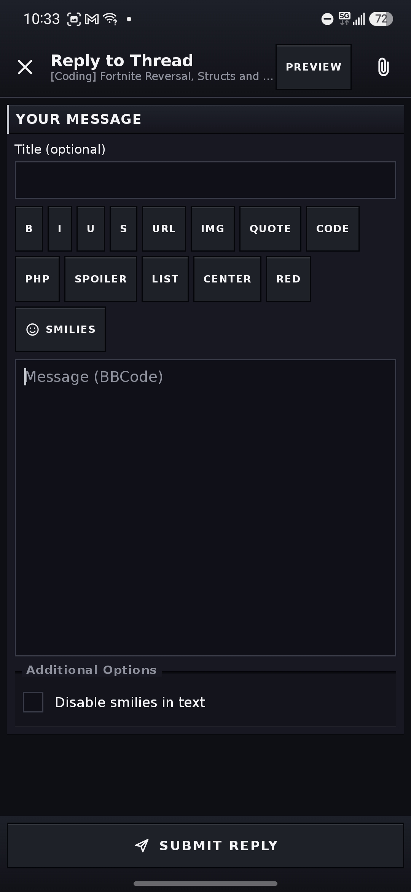
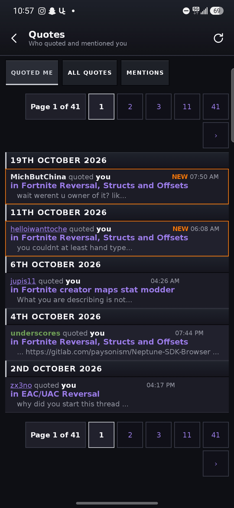

# UnknownCheats Mobile
Full mobile port of unknowncheats into an android mobile application. This is not a professional release and was originally just a side project for myself to make posting on UC while at work easier.

## Source Code Release

This app works by scraping all info unknowncheats HTML due to not having backend access. This leads to having to verify cloudflare every once and a while to view the next page (when changing networks especially or editing profile/settings). I want to add a bypass at some point but idk if I care enough. There are also probably some other bugs so please open an issue and let me know what to fix!

I will be releasing the source code in the next few days I have a few bugs to fix and some cleanup to do but for the most part v2 is done. Here are some screenshots from the latest patch showing some of the design and features offered:

# Preview Photos

## AI Disclosure

This project was completely vibecoded as obviously im not learning how to make android apps just for unknowncheats + it wouldve been complete dogshit.

# Credits

Made By Payson and Claude with love ❤️
